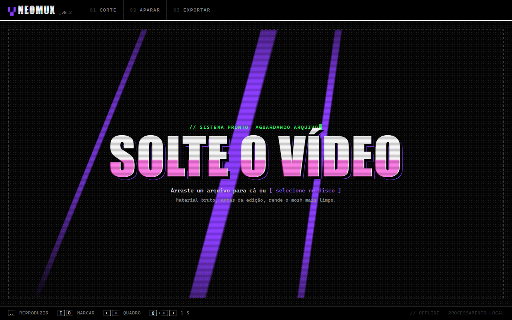

# NeoMux

Datamosh rápido, no estilo Avidemux, sem precisar caçar quadro-chave na mão.



## Como funciona

1. **Corte**: importe um vídeo e marque o trecho a remover (`I` / `O`).
2. **Datamosh**: o NeoMux junta os dois lados e apaga o quadro-chave da emenda, então o movimento de depois "escorre" sobre a imagem de antes. O **Bloom** repete um quadro de movimento para o borrão crescer.
3. **Aparar e exportar**: deixe só a transição e renderize na resolução e no fps que quiser.

Estilos prontos (Suave, Derretido longo, Clássico, Pixelado) e ajustes finos de blocos, persistência, suavização e fim do efeito.

**Exportação:** sem perdas (FFV1, PNG, H.264 4:4:4, VP9), ProRes 4444 XQ, DNxHR 444 ou no bitrate do original. Vídeos HDR e com fps variável de celular são convertidos automaticamente.

## Como usar

Requer [Node.js](https://nodejs.org). O ffmpeg vem junto.

```bash
npm install
npm run app     # abre em janela própria
npm start       # só o servidor: http://localhost:5177
```

No Windows, também dá para dar dois cliques em **NeoMux.vbs**.

**Atalhos:** `espaço` reproduz · `←`/`→` 1 quadro (`Shift`: 1 s) · `I`/`O` marcam · `Esc` cancela.

As exportações ficam em `Vídeos\NeoMux`.

## Licença

[MIT](LICENSE)
